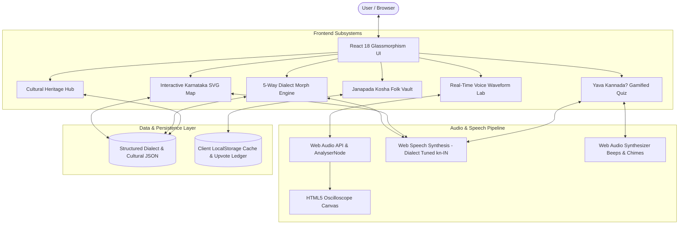

# KannadaVaividhya (ಕನ್ನಡ ವೈವಿಧ್ಯ) 
### 🗺️ The Interactive Regional Kannada Dialect & Cultural Explorer

[](https://unstop.com)
[](https://nie.ac.in)
[](#problem-statement)
[](https://reactjs.org/)
[](https://vitejs.dev/)
[](https://tailwindcss.com/)

> **"ಸಿರಿಗನ್ನಡಂ ಗೆಲ್ಗೆ, ಸಿರಿಗನ್ನಡಂ ಬಾಳ್ಗೆ!"**  
> An interactive web and speech intelligence platform documenting, comparing, and celebrating the living regional dialects, oral idioms, and cultural tapestry of Karnataka.

---

## 📌 Problem Statement Details

- **Event:** Kannada Digital Innovation Hackathon 2026
- **Host:** HackerRank Campus Crew & The National Institute of Engineering (NIE), Mysuru
- **Chosen Challenge:** **Problem Statement 04 — Namma Kannada: Regional Language Explorer**
- **Objective:** *Develop an interactive platform to document and explore regional variations of Kannada, including local words, phrases, expressions, pronunciation, and cultural context.*

---

## 💡 The Core Problem & Our Vision

While formal, standardized Kannada is taught in classrooms and official documents, everyday communication in Karnataka thrives across diverse regional dialects:
1. **Old Mysuru (ಮೈಸೂರು-ಮಂಡ್ಯ):** Polite, aristocratic, melodic, courtly respect (*"ಮಾಡಿದ್ದೀರಾ", "ಬನ್ನಿ", "ತೊಂದರೆ ಇಲ್ಲ"*).
2. **North Karnataka (ಧಾರವಾಡ-ಬೆಳಗಾವಿ):** Robust, earthy, rapid tempo, expressive markers (*"ಏನ್ರೀ ಸಮಾಚಾರ", "ಆಮ್ಯಾಲೆ", "ಬರ್ರಿ"*).
3. **Coastal Karavali (ಕುಂದಾಪ್ರ-ಮಂಗಳೂರು):** Musical sing-song lilt, maritime rhythm, Tulu/Konkani confluence (*"ಬರಿ ಬಿಸಿ ಕೂಡು", "ಎಲ್ಲಿಗ್ ಪೋಪುದು", "ತಡಿ ಮಾರಾಯ"*).
4. **Kalyana Karnataka (ಕಲಬುರಗಿ-ಬೀದರ್):** Deccani-intertwined soul, Sharana philosophical heritage (*"ಬರಾಬರ್ ಅದ", "ಕಾಯ್ ಮಾಡೊನು", "ಹೌದಲ್ಲೊ"*).
5. **Bengaluru Urban (ಬೆಂಗಳೂರು ಸ್ಲ್ಯಾಂಗ್):** Fast-paced cosmopolitan hybrid, auto lingo & tech wit (*"ಬೇಜಾನ್", "ಮಗಾ", "ಸೀನ್ ಇಲ್ಲ", "ಚಿಂದಿ"*).

Traditional translators and generic language apps (Duolingo, Google Translate) are **100% blind** to these regional differences. **KannadaVaividhya** bridges this divide by providing an audio-first, interactive, and community-powered dialect explorer.

---

## 🌟 Key Features

### 1. 🗺️ Interactive Regional Geo-Explorer (Karnataka SVG Map)
- Interactive vector map divided into 5 primary linguistic regions covering all 31 districts.
- Clicking any region reveals historical roots, phonetic rules, cultural landmarks (Yakshagana, Vachanas, Dasara), and signature greetings.
- Integrated Text-to-Speech audio configured with regional cadence.

### 2. 🔄 5-Way "Dialect Morph" Cross-Translator
- Select everyday situational categories: *Greetings & Enquiries, Auto & Commute Bargaining, Food & Dining, Work & Daily Life, Slang & Exclamations*.
- Immediate side-by-side comparative cards with:
  - Regional Kannada script
  - English phonetic transliteration
  - Cultural etiquette nuance
  - Dialect-tuned audio playback & copy-to-clipboard button.
- **Custom Dialect Synthesizer:** Type any custom thought to see simulated regional adaptations.

### 3. 🎙️ Real-Time Audio Frequency Lab (Dhwani Prayogashale)
- Powered by the native browser **Web Audio API** and `AnalyserNode`.
- Visualizes the speaker's live voice as an oscilloscope waveform on an HTML5 canvas.
- Evaluates pronunciation with an acoustic match percentage and provides regional accent tips.

### 4. 🎮 "Yava Kannada?" — Gamified Dialect Detective Quiz
- 6 interactive rounds testing regional listening comprehension.
- Authentic dialect quotes with audio clues, streak tracking, sound effects, and celebratory **confetti animation**!
- Rewards 3 tiers of cultural badges (*ಕನ್ನಡ ಪ್ರೇಮಿ*, *ಪ್ರಾದೇಶಿಕ ಪಂಡಿತ*, *ಕವಿರಾಜಮಾರ್ಗ ವಿದ್ವಾಂಸ*).

### 5. 📚 "Janapada Kosha" — Crowdsourced Living Folk Vault
- Searchable, filterable repository of 50+ authentic proverbs (*Gaadegalu*), local idioms, and slang.
- Live upvoting counter persisted in local storage.
- Interactive modal allowing users from any district to contribute local phrases.

### 6. 🏛️ Cultural Heritage & Literature Showcase
- Deep-dive into each region's folk drama, literary titans (Kuvempu, Da. Ra. Bendre, Basaveshwara, Karanth, Masti), festivals, and regional cuisine.

---

## 🏗️ System Architecture



---

## 🛠️ Technology Stack

| Layer | Technologies Used |
| :--- | :--- |
| **Frontend Framework** | React 18, Vite 8 |
| **Styling & Design** | Tailwind CSS v4, Custom Glassmorphism, Google Fonts (*Noto Sans Kannada*) |
| **Icons & Visuals** | Lucide React |
| **Audio & Speech** | Web Audio API (`AudioContext`, `AnalyserNode`), Web Speech API (`SpeechSynthesisUtterance`) |
| **Gamification** | `canvas-confetti`, Pure Web Audio Synthesizer sound effects |
| **Presentation Deck** | Python `python-pptx` (16:9 widescreen automated deck) |
| **Deployment** | Vercel / Netlify Edge CDN (`vercel.json` configured) |

---

## 🚀 Quick Start / Local Installation

### Prerequisites
- Node.js (v18 or v20+)
- npm or pnpm or yarn
- Python 3.10+ *(only if modifying or re-generating the presentation deck)*

### Steps to Run

1. **Clone the Repository:**
   ```bash
   git clone https://github.com/your-username/KannadaVaividhya.git
   cd KannadaVaividhya
   ```

2. **Install Dependencies:**
   ```bash
   npm install
   ```

3. **Start the Development Server:**
   ```bash
   npm run dev
   ```
   Open [http://localhost:5173](http://localhost:5173) in your browser.

4. **Build for Production:**
   ```bash
   npm run build
   ```
   The optimized production bundle will be generated in `dist/`.

5. **Generate the Presentation Deck (.pptx):**
   ```bash
   python scripts/generate_presentation.py
   ```
   Generates `KannadaVaividhya_Presentation.pptx` in the project root.

---

## 📂 Project Structure

```
d:\KannadaHackathon\
├── index.html                           # App entry point with Noto Sans Kannada fonts
├── package.json                         # Dependencies & npm scripts
├── vite.config.js                       # Vite configuration with Tailwind CSS plugin
├── vercel.json                          # Edge deployment routing config
├── .env.example                         # Environment template
├── README.md                            # Comprehensive project documentation
├── KannadaVaividhya_Presentation.pptx   # Official 8-slide presentation deck
├── scripts/
│   ├── generate_presentation.py         # Python-pptx automated presentation generator
│   └── video_pitch_script.md            # Exact 3-5 minute timed video voiceover script
└── src/
    ├── main.jsx                         # React root mount
    ├── App.jsx                          # Main app container & section routing
    ├── index.css                        # Tailwind v4 import & custom styling
    ├── data/
    │   ├── regions.js                   # 5 regional dialect profiles & cultural metadata
    │   ├── phrases.js                   # 5-way multi-dialect comparative matrix
    │   ├── quizData.js                  # Dialect trivia questions & badge definitions
    │   └── folkVault.js                 # Initial crowdsourced folk repository
    ├── utils/
    │   └── audioHelper.js               # Web Speech synthesis & Web Audio API SFX
    └── components/
        ├── Navbar.jsx                   # Sticky navigation & region quick selector
        ├── HeroSection.jsx              # Banner with audio greeting & quick stats
        ├── KarnatakaMap.jsx             # Interactive SVG map & linguistic details pane
        ├── DialectMorph.jsx             # 5-way cross-translator & custom sentence morph
        ├── AudioLab.jsx                 # Real-time microphone waveform oscilloscope
        ├── DialectQuiz.jsx              # Gamified 'Yava Kannada?' detective quiz
        ├── FolkVault.jsx                # Searchable folk repository & contribution modal
        ├── RegionalShowcase.jsx         # Cultural heritage, literature & cuisine
        └── Footer.jsx                   # NIE Mysuru & HackerRank acknowledgment
```

---

## 🏆 Hackathon Deliverables Checklist

- [x] **Problem Statement**: Selected **PS 04 (Namma Kannada — Regional Language Explorer)**.
- [x] **Working Prototype**: Full React 18 single-page application built, tested, and production-ready.
- [x] **Presentation Deck**: `KannadaVaividhya_Presentation.pptx` generated covering Problem, Existing Gaps, Differentiation, Methodology, Architecture, and Conclusion.
- [x] **Video Explanation**: Comprehensive word-for-word 3–5 min script in `scripts/video_pitch_script.md`.
- [x] **Deployment Config**: `vercel.json` and static build verified for 1-click cloud deployment.

---

## 👥 Acknowledgments
Developed with passion for the **Kannada Digital Innovation Hackathon 2026**, organized by:
- **HackerRank Campus Crew**
- **The National Institute of Engineering (NIE), Mysuru**

*Celebrating Karnataka's timeless heritage and linguistic richness through code.*
